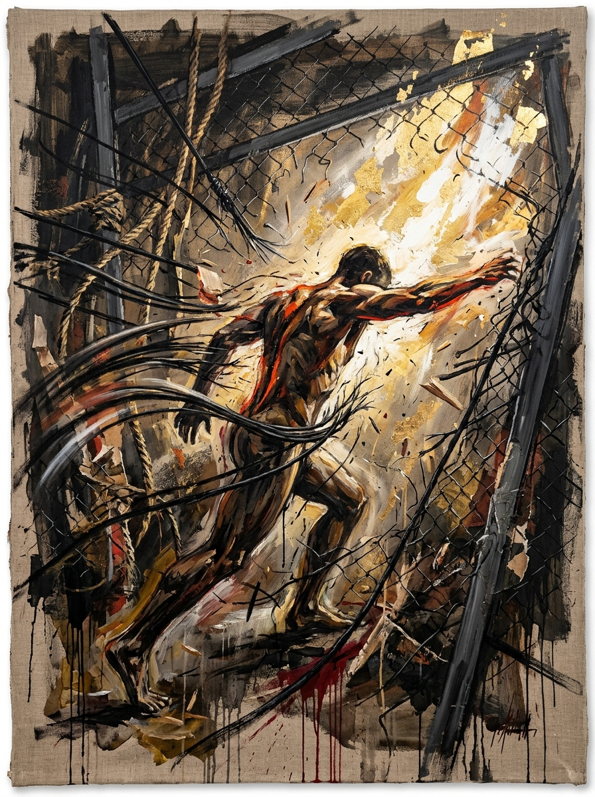
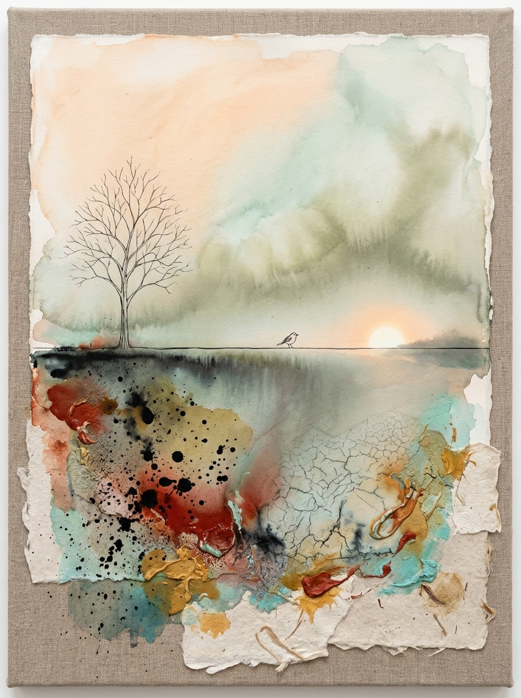

# 形而上视觉转译引擎（Metaphysics to Image）

将诗词、哲理与抽象文字转译成有语义关联、情绪和视觉想象力的意象画。Skill 将文字的主体与关系转成画面事件，再选择能够承载情绪的笔触、材质和空间语言。

## 使用

安装到 Codex：

```bash
git clone https://github.com/dichenxiang/metaphysics-to-image.git ~/.codex/skills/metaphysics-to-image
```

在支持技能的环境中输入，例如：

```text
使用 metaphysics-to-image 生成图片：醉后不知天在水，满船清梦压星河
```

根据环境中可用的图像生成工具，技能会生成图片或提供可用的提示词。指定参考图、比例和风格时，以用户要求为准。

## 转译过程

1. 理解分句之间的关系、主体、处境、语气和情绪变化。
2. 提出一个画面事件，让主体和所处的力量关系共同承载原句。
3. 按内容选择线条、色层或其他视觉形式，使主体与周围空间产生联系。
4. 从参考分析中选取适合的视觉机制，再编写提示词。
5. 检查文字关联、情感、细节、画面清洁度及实际生成结果。

人物和具体意象根据文字及用户意图决定；不预设所有诗句都需要人物、金线或黑色背景。参考素材用于分析视觉机制，实际创作应形成新的构图与表达。

## 文件结构

- [SKILL.md](SKILL.md)：技能入口与文字到图像的转换链路。
- [意象画参考分析](references/imagery11-analysis.md)：参考画面的笔触、主体、力场及图文证据分析。
- [画面清洁度规则](references/image-cleanliness.md)：细节分布、明暗、锐度与材质控制。
- [图文对应案例](references/text-image-pair-examples.md)：用户提供的文字与画面关系。
- [验证方法](references/conversion-evaluation.md)：对照案例与实际成图检查。
- [逐图风格档案](references/all-images-analysis.md)：历史参考素材的分析；按需查阅。
- `assets/`：参考素材及索引；`examples/` 中的展示记录为早期版本案例。

截图中的界面和截断标题不作为生成内容或确定的完整图注；参考图片的具体来源与权利请分别核实。

## 早期示例

<table><tr><td width="50%"></td><td width="50%"></td></tr></table>

更多早期案例见 [examples/showcase.md](examples/showcase.md)。

## 许可证

本项目代码与文字基于 [MIT License](LICENSE)；参考图片的权利状况以其各自来源为准。
