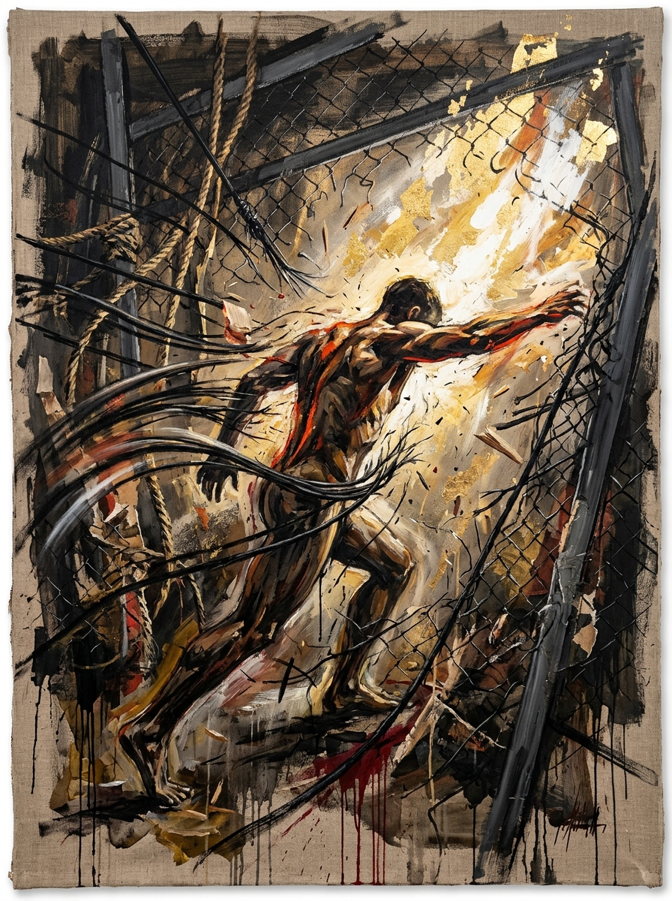
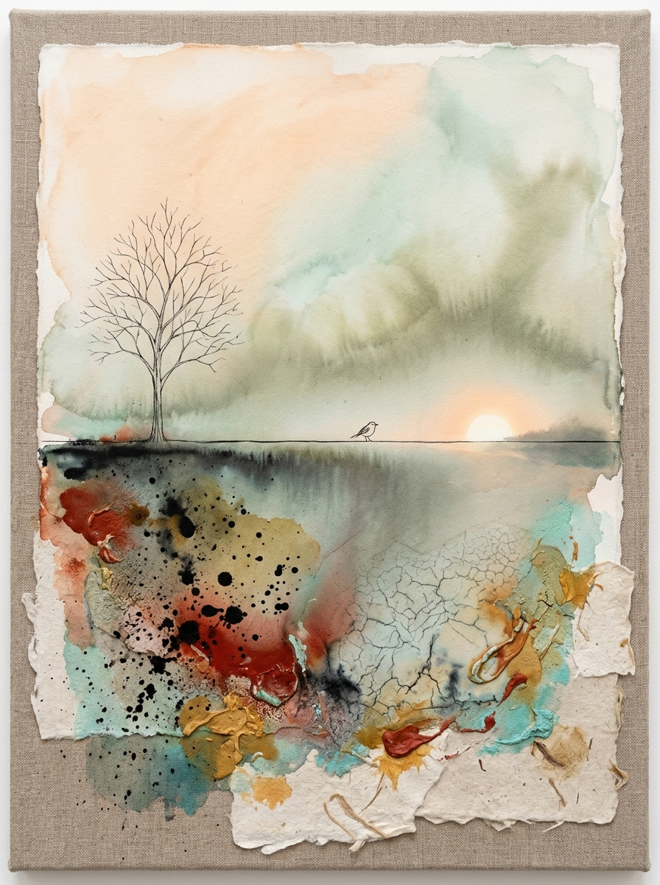

# 案例研究与推演画廊 (Case Studies & Aesthetic Showcase)

本目录记录了 `metaphysics-to-image` 实际运行中的经典推演案例。展示如何从极其抽象、主观上无视觉描述的哲理短句，通过五阶推演与自反性审查，生长出具备美术馆原作质感的视觉艺术方案。

---

## 案例一：“永别了，牢笼”

### 1. 哲思本体与矛盾深潜
* **哲学命题剖析**：“牢笼”不仅是物理桎梏，更是规训、形骸、疲惫过往与社会身份的重负。“永别了”是不可逆的暴力决裂。核心张力在于【束缚肉身的极度紧绷与重力】vs【破障瞬间撕裂网膜的狂暴爆发力】。
* **复合情绪基调**：【决绝的撕裂】、【肉身的痛感】与【超越一切的狂喜（Catharsis）】。
* **门禁一自查**：`[PASS]` 剔除卡通白鸽、铁链火花等儿童插画套路。

### 2. 异象物理与世界观法则
* **高张力物理回弹**：被撕裂的工业铁索在半空中发生如受击琴弦般的剧烈弹跳甩动。
* **极度光暗反差**：牢笼内部的沥青重黑被外界涌入的熔金破晓强光瞬间斩裂。

### 3. 心象实体涌现与质感
* **画面形式**：粗糙生亚麻布上，具象表现主义的健硕躯体正生生撞穿崩断的铁丝护网。脊梁上有一道如熔岩般的朱砂红与墨迹，前方是倾泻而下的钛白与真金箔光暴，画布底部带着淋漓的松烟墨滴。
* **门禁三/四自查**：`[PASS]` 零命中 `anti_tropes.md`；质感具备浓重刮刀油彩（Impasto）与实体艺术手作痕迹。

### 4. 视觉成果


---

## 案例二：“你说，今天和明天有什么区别”

### 1. 哲思本体与矛盾深潜
* **哲学命题剖析**：对时间人为划分的荒谬感与西西弗斯式重复的困惑。核心在于人类渴望明天带来改变，而宇宙时间呈现绝对同一的连续性（绵延 Durée）。
* **复合情绪基调**：【冷凝的微惘】与【清醒的荒谬感】。

### 2. 心象实体涌现与质感
* **画面形式**：综合材料绘画。未漂白粗织亚麻布衬底上，覆着带有撕裂毛边的手工棉纸（Deckle-edge paper）。一道手绘极细墨线视平线分割天地，落日将沉未沉。细线上停歇着一羽微小的飞鸟对视夕阳，下半部是开裂的冰裂釉纹、天然矿物厚涂（朱砂、赭石、石青）与飞溅水墨。
* **艺术成果展示**：


---

## 案例三：“回首向来萧瑟处，归去，也无风雨也无晴”

### 1. 哲思本体与矛盾深潜
* **哲学命题剖析**：超脱晴雨得失的二元对立，抵达内心绝对澄澈自洽的“大空性”。
* **艺术媒介**：冷调水墨浅绛 × 微妙漫射光光学。
* **Prompt 预览**：
```text
A sublime contemporary Zen mixed-media painting. An infinite quiet lake surface blending imperceptibly into a pale celadon mist without ripples. In the mid-ground, a single weathered stepping stone emerges from the glassy water, holding a quiet residue of rain that has ceased falling. Zero wind, absolute stillness, soft neutral ambient light without cast shadows, subtle sumi-ink washes fading into unpainted raw linen negative space, masterwork of transcendence and inner silence --ar 16:9 --style raw
```
